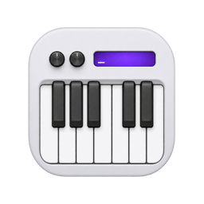
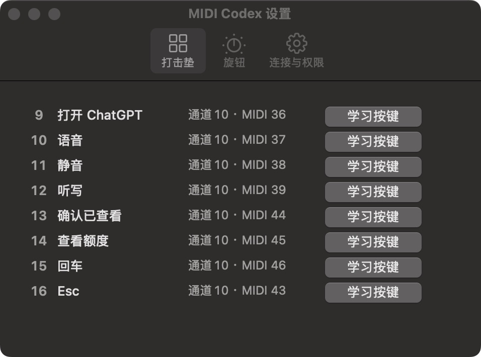
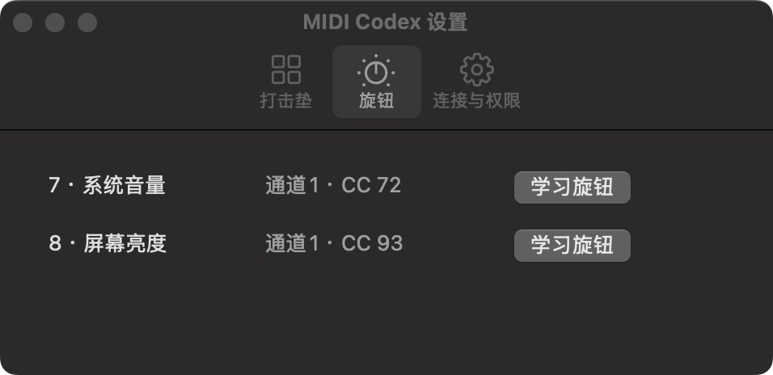
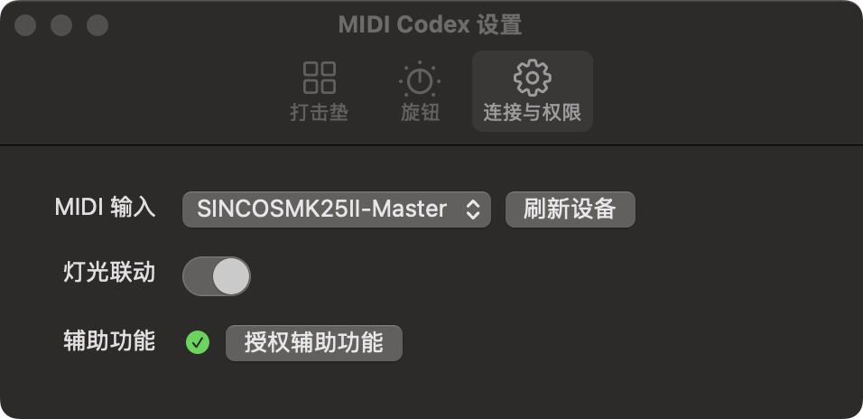

<p align="center">
  
</p>

<h1 align="center">MIDI Codex</h1>

<p align="center">用 MIDI 打击垫操控 macOS 上的 ChatGPT 和 Codex，抬眼就能看到任务状态。</p>

<p align="center">
  <a href="#快速开始">快速开始</a> · <a href="#键位与灯效">键位与灯效</a> · <a href="#从源码构建">从源码构建</a>
</p>

<p align="center">
  
</p>

## 快速开始

1. 连接 MIDI 键盘并打开 MIDI Codex。在菜单栏点击琴键图标打开设置。
2. 在「连接与权限」选择 MIDI 输入。首次使用时，应用优先选择名称包含 `Master` 的设备。
3. 在「打击垫」或「旋钮」点击学习按钮，再操作对应的实体控件。绑定即时保存到本机。
4. 语音、听写、状态检测和发送回车或 Esc 需要辅助功能权限。到「连接与权限」授权，看到绿勾即可。

关闭设置窗口后联动会继续运行。从菜单栏选择「退出」即可停止。

| 旋钮 | 连接与权限 |
| :---: | :---: |
|  |  |

## 键位与灯效

下排打击垫从左往右：

| 位置 | 功能 |
| --- | --- |
| 1 | 打开或切回 ChatGPT |
| 2 | 开关语音 |
| 3 | 切换语音静音 |
| 4 | 听写 |
| 5 | 确认已查看，清除上排提示 |
| 6 | 查看 Codex 每周剩余额度，用灯数和颜色显示 |
| 7 | 向前台 ChatGPT 发送回车 |
| 8 | 向前台 ChatGPT 发送 Esc |

旋钮 **7** 调整系统音量，旋钮 **8** 调整屏幕亮度。

启用灯光联动后，上排八颗打击垫显示 Codex 状态：

| 状态 | 灯效 |
| --- | --- |
| 空闲 | 白色呼吸 |
| 运行中 | 白灯从左往右逐颗循环 |
| 等待审批 | 全排持续闪黄 |
| 有结果待查看 | 全排闪三次嫩绿，再保持嫩绿呼吸 |
| 出错或中断 | 全排持续闪红 |

灯光联动已在 **SINCO SMK25II** 上验证。灯色临时生效，断电后键盘恢复自身预设。

## 从源码构建

需要 macOS 和 Xcode Command Line Tools。在仓库根目录运行：

```sh
./build.sh .build/apps
open ".build/apps/MIDI Codex.app"
```

构建目录需没有同名 App。项目还包含 [Pad Lights](PadLights/README.md)，可以单独控制十六个打击垫的颜色和开关。

[主程序源码](Sources/MIDICodex) · [灯光协议](PadLights/PROTOCOL.md)
